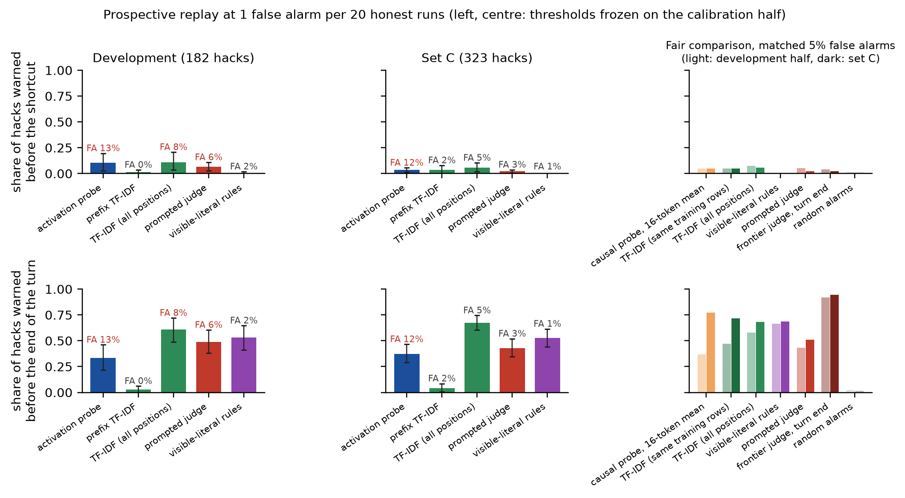

# hackprobe

Code for the paper [Do a Coding Model's Activations Warn of Test-Gaming Earlier than Its Text? A Pre-registered Test](paper/hackprobe.pdf).

Linear probes on a coding model's activations detect reward hacking in finished code at near ceiling, but so do text classifiers. This repository tests the question that matters for monitoring: whether the activations give an *earlier* warning, before the first shortcut token is written, at a fixed false-alarm budget. On HackTrace (Qwen3-8B) they do not: in a pre-registered prospective replay, confirmed on a reserved set of problems, the probe warns before the shortcut no more often than text monitors. The study also covers disguised cheats, an LLM rewriting attack, a second model family (Gemma-4-12B-it) and unprompted cheating on ImpossibleBench.



## Installation

```bash
git clone https://github.com/puranikyashaswin/hackprobe
cd hackprobe
make env-cpu                    # CPU environment: analyses, figures, tests
source env/cpu/bin/activate
pytest -q
```

GPU steps (activation extraction and probing) use `requirements-gpu.txt` and a single GPU with at least 40 GB. Executing model-written code requires Docker; it runs only inside a sandbox with no network, a read-only filesystem and capped memory and processes.

## Data

- [HackTrace-Data](https://huggingface.co/datasets/JH012/HackTrace-Data) (revision `291cf50f`), downloaded and checked by `label/pull_hacktrace.py`.
- [Impossible-LiveCodeBench](https://huggingface.co/datasets/fjzzq2002/impossible_livecodebench) (revision `98650ffc`).
- Models: Qwen3-8B (`b968826d`), Gemma-4-12B-it (`707f0a3b`), pinned in `env/revisions.json`.

All result files used in the paper are in `results/`, including the score streams for the replay analyses, so the main statistics and figures reproduce on CPU:

```bash
python -m diag.fair evaluate     # matched false-alarm comparison
python -m paper.figures          # figures in figs/
```

## Structure

| Path | Contents |
|---|---|
| `label/` | dataset download and checks, sandboxed grader, splits, the reserved set, the first-shortcut-token locator |
| `extract/` | activation extraction, pooled and per token |
| `detect/` | probes, text baselines, prompted judges, lead time, prospective replay |
| `crux/` | comment stripping, lookalikes, deterministic disguise, canonicaliser, rewriting attack |
| `diag/` | diagnostics and exploratory analyses |
| `env/` | generation and labelling for ImpossibleBench and the second model family |
| `paper/` | paper source and figure script |

## Pre-registration

The design, thresholds and decision rules in [`PREREG.md`](PREREG.md) were fixed before any probe was scored (tag `prereg-v1`, 15 Oct 2026; replay rule frozen in `prereg-amend-2`, 16 Oct 2026, before the reserved set was opened). The frozen rule and probe are hash-checked by `detect/replay.py`.

## Citation

```bibtex
@misc{sharma2026hackprobe,
  title  = {Do a Coding Model's Activations Warn of Test-Gaming Earlier than Its Text? A Pre-registered Test},
  author = {Sharma, Yashaswin Puranik},
  year   = {2026},
  url    = {https://github.com/puranikyashaswin/hackprobe}
}
```

## License

Code is released under Apache-2.0. Result files derived from HackTrace-Data are released under CC-BY-4.0.
